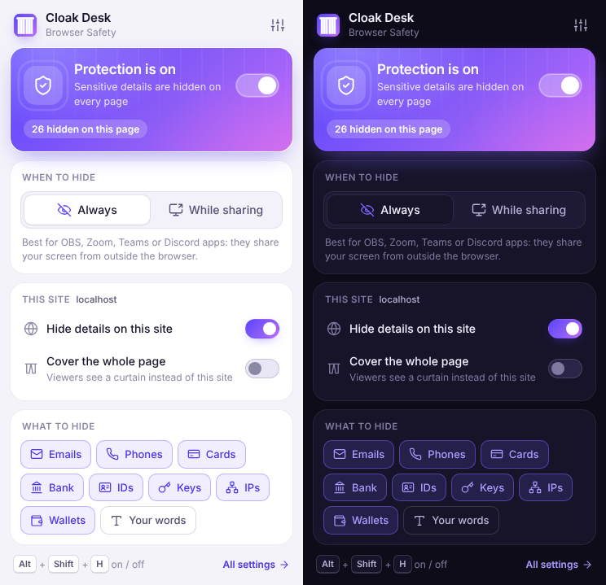
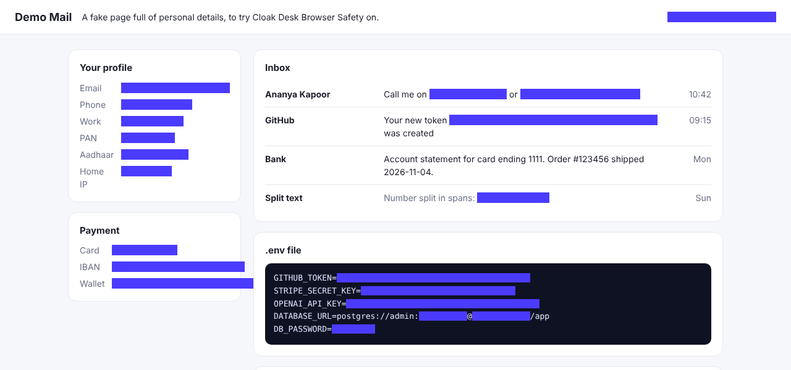
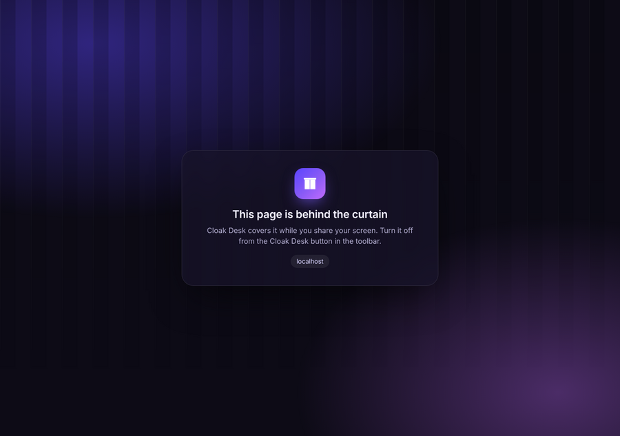
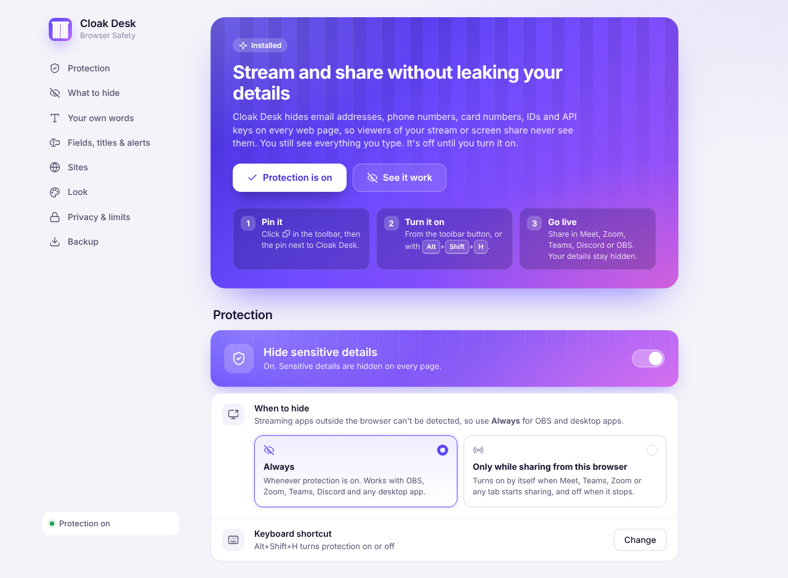

# Cloak Desk Browser Safety (Chrome, Edge, Brave and other Chromium browsers)

Hides email addresses, phone numbers, card numbers, IDs, API keys and your own words on every web page
while you stream or share your screen. You keep working normally; viewers see a bar where the detail was.



It is the browser half of Cloak Desk: [Cloak Desk for Windows](../windows/README.md) curtains whole apps,
and this extension hides the details *inside* web pages.

## Install it in your browser (2 minutes)

1. Get the folder: download this repository (**Code → Download ZIP** on GitHub, then unzip), or download
   `CloakDesk-Browser-<version>.zip` from [Releases](https://github.com/raktim-yoddha/cloak-desk/releases) and unzip it.
2. Open `chrome://extensions` (Edge: `edge://extensions`, Brave: `brave://extensions`).
3. Turn on **Developer mode** (top right).
4. Click **Load unpacked** and pick the `chromium/extension` folder (or the folder you unzipped the release into,
   the one that contains `manifest.json`).
5. A welcome tab opens. Protection is **off** until you turn it on: click **Turn on protection**,
   or the Cloak Desk button in the toolbar, or press **Alt+Shift+H**.
6. Pin it: click the puzzle icon in the toolbar, then the pin next to Cloak Desk.

Needs Chrome/Edge/Brave 120 or later.

### See it work

Open [`demo/index.html`](demo/index.html), a fake mail page full of personal details:

- Serve it: `npx serve chromium/demo` (or `python -m http.server -d chromium/demo`) and open the address it prints, or
- open the file directly after turning on **Allow access to file URLs** in the extension's **Details** page.

Toggle protection from the toolbar and watch every detail get covered. The demo also has buttons to start a
screen share (to try **While sharing** mode), add new messages live and show a notification.



## What it hides

| | Examples | How it avoids false alarms |
|---|---|---|
| Emails | `name@example.com` | full address shape |
| Phone numbers | `+91 98765 43210`, `(415) 555-0132` | 8–15 digits; dates, times, versions, IDs and Unix timestamps are skipped |
| Payment cards | `4111 1111 1111 1111` | Luhn checksum |
| Bank accounts | `GB82 WEST 1234 5698 7654 32` | IBAN mod-97 checksum |
| Government IDs | Aadhaar, PAN, US SSN, UK NI number | Verhoeff checksum (Aadhaar), official formats |
| API keys, tokens, passwords | GitHub, GitLab, AWS, Stripe, Google, OpenAI, Anthropic, Slack, npm, Hugging Face, JWTs, private keys, `password=…`, `Bearer …`, `user:pass@` in URLs | known prefixes; for `key = value` only the value is hidden |
| IP addresses | `203.0.113.42`, IPv6 | valid octets, real IPv6 parse; localhost skipped |
| Crypto wallets | Ethereum, Bitcoin | address formats |
| **Your own words** | your name, home address, company, clients | exact text, any case. Also regular expressions. |

Each one can be switched off. Select text on any page, right-click and choose **Always hide “…”** to add it to your words.

### Also

- **Form fields**: what you type in email, phone, card, address, password, OTP and token fields shows as dots,
  even after you click a “show password” eye.
- **Tab titles**: `Inbox - you@gmail.com - Gmail` becomes `Inbox - ••••• - Gmail` in the tab strip.
- **Notification previews**: desktop pop-ups from open sites show only the site name, not the message.
- **Curtain sites**: pages such as your password manager or bank are covered completely
  (password manager sites are on the list by default).
  
- **Never-hide sites**, three mask styles (Redact, Frosted, Tint) and any color, export/import of settings.

### When to hide

- **Always** (default): whenever protection is on. Use this for OBS, Zoom, Teams, Discord and other desktop apps,
  which share the screen from outside the browser where an extension can't see them.
- **Only while sharing from this browser**: protection turns on by itself when Google Meet, Teams, Zoom or any tab
  calls the browser's screen-share API, and turns off when the share ends. The toolbar badge turns red while a share is live.



## How it works

- **Masks are painted, the page is never changed.** Sensitive text is found and covered with the
  [CSS Custom Highlight API](https://developer.mozilla.org/docs/Web/API/CSS_Custom_Highlight_API): live ranges styled
  as a bar in the same paint as the text. React/Angular apps, editors and `contenteditable` keep working, and the mask
  moves with the text while scrolling.
- **Nothing unmasked is painted.** While protection is on, a tiny stylesheet keeps each new page invisible until the
  first scan (a failsafe reveals it after 1.5 s no matter what). New text is checked by a `MutationObserver` in the
  same task, before the next frame.
- **Everywhere on the page**: iframes, open and closed shadow roots (web components), text split across `<b>`/`<span>`.
- **Hard to undo by accident**: each page gets a random highlight name; a page calling `CSS.highlights.clear()` only
  clears its own highlights; masks and styles are re-checked every frame and restored before paint.
- **Selection guard**: selecting text over a mask doesn't reveal it.

Code map:

| File | Role |
|---|---|
| `extension/src/shared/detectors.js` | patterns, checksums, custom words |
| `extension/src/shared/masker.js` | highlight engine, form fields, selection and tamper guard |
| `extension/src/content/mask.js` | per-page controller: settings, titles, curtain |
| `extension/src/content/share-hook.js` | page-world hook: screen-share detection, notifications, `clear()` guard |
| `extension/src/background/sw.js` | badge, icon, shortcut, right-click menu, share tracking |
| `extension/src/popup/`, `extension/src/options/` | toolbar panel and settings page |

## Privacy and security

- No servers, no analytics, no accounts, no network code. The popup, settings page and background worker are blocked
  from the network by the extension's Content Security Policy (`connect-src 'none'`), and `npm run check` fails the
  build if `fetch`, `XMLHttpRequest`, `WebSocket`, `eval` or remote scripts ever appear.
- Settings, including your words, live in `chrome.storage.local` on this device. Never synced.
- Permissions: `storage`, `scripting` (to cover tabs that were already open when you installed it),
  `contextMenus` (right-click actions) and access to all sites (to find sensitive text on whatever you show).
- No `web_accessible_resources`, so pages can't detect the extension through its files.
- Messages from pages are validated; only extension pages can query or reset state.

Full policy: [PRIVACY.md](PRIVACY.md).

### Limits

It can't hide Chrome's own UI (address bar, autofill pop-ups, bookmarks bar), `chrome://` pages and the Chrome Web
Store (Chrome blocks extensions there), text inside images, videos, PDFs and canvas-drawn apps (Google Docs, Figma),
or matches highlighted by the Find bar (Ctrl+F). Other desktop apps are outside the browser: use Cloak Desk for Windows.

## Develop

```bash
cd chromium
npm ci                       # Playwright, for the browser test
npx playwright install chromium
npm run check                # manifest + security rules
npm test                     # detector unit tests
npm run e2e                  # loads the extension in Chromium, screenshots in test-results/
npm run pack                 # dist/CloakDesk-Browser-<version>.zip
npm run icons                # re-render icons from assets/*.svg
```

After editing files, click the reload icon on the extension's card in `chrome://extensions`.
CI (`.github/workflows/chromium.yml`) runs all of the above on every push that touches `chromium/`,
and the release workflow attaches the zip to each GitHub release.

The version lives in `extension/manifest.json` and `package.json` (kept equal by `npm run check`).
